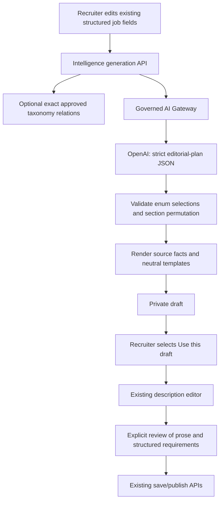

# AI Job Description Generator V1

This feature is implemented locally and remains disabled by default. It does not publish jobs or enable OpenAI. See the accompanying [implementation and QA report](C:/Users/Admin/Documents/SapienWorx/tmp/intelligence-v2-openai-gateway/docs/ai-jd-generator-v1-report.md).

## Source of truth

The existing `recruiter.DetailedJobInput`, job builder and `jobs` persistence remain authoritative. `GenerationFields` is a restricted transport projection of those fields, not a second job model. The generator changes only the description after the recruiter chooses **Use this draft**. It never calls `job.parse` and never derives matching fields from prose.

The V1 reconciliation policy is explicit structured editing (option B). Adding “Kubernetes is mandatory” to prose does not add Kubernetes to `required_skills`. The recruiter must edit the skills field separately. Any changes to the reviewed description or public structured requirements invalidate the previous review.

## Request and response

`POST /api/v1/intelligence/jobs/generate-description`

Authentication, current session, CSRF, active company membership and `jobs.manage` permission are required. The server derives actor/tenant/correlation IDs; clients cannot choose a model, prompt or tenant.

```json
{
  "version": "v1",
  "external_ai_consent": true,
  "fields": {
    "title": "Software Engineer",
    "location": "Bengaluru",
    "min_experience_years": 0,
    "max_experience_years": 3
  }
}
```

Both experience endpoints are required integers in 0–60, with maximum >= minimum. Optional existing fields are employment type, work mode, department, role category, skills, responsibilities, company overview, why join and education requirements. Unrecognized fields are rejected. Private salary, notes, assignment, referral rules and screening answers are excluded. Existing salary fields remain private and editable in Hiring workflow.

The private response uses the existing artifact envelope: `id`, `revision`, `expires_at`, and `result`. Result includes task, versions, provider/model, schema/domain validation, usage, estimated-cost/unknown-price state, latency and `value.generated_description`. `value` also includes `generated_by_ai`, `requires_recruiter_review`, structured input fields, `suggested_skills`, warnings and regeneration count. Operational provider request IDs stay in private operational evidence and are stripped from the product response. Responses use `Cache-Control: no-store`.

Version identifiers:

| Identifier | Value |
|---|---|
| Request version | `v1` |
| Task | `job.generate_description` |
| Task implementation version | `v1.1` |
| Prompt version | `jd-p1` |
| Output schema version | `jd-generation-v1` |
| Configured model | `gpt-6-luna` |
| Service tier | `default` (Standard) |

## Generation boundary



The model selects one of three reviewed openings and a permutation of the supplied section IDs. It cannot return new free-text claims. SapienWorx assembles the title, introduction, supplied responsibilities/skills/qualifications/company text, experience, location/work mode and optional employment type. Unsupported sections are omitted. Missing duties/skills produce actionable warnings; existing publication requirements still apply.

This is deliberately a constrained drafting assistant, not an unrestricted copywriter. Minimal input produces a short factual draft rather than invented responsibilities or qualifications. A model cannot invent a salary, benefit, company name/culture/size, technology, certification, degree, remote policy, visa/travel/shift/notice requirement or employment term because none of those free-text output slots exist. Supplied text remains untrusted data, is rendered as text, and is still subject to recruiter review. The small prohibited-phrase filter is a defensive check, not a comprehensive hiring-law/content classifier.

Taxonomy suggestions use only exact active occupations and approved `occupation_competency` relationships. No fuzzy occupation guess is promoted. Suggestions stay outside the provider facts and generated JD, and outside matching requirements until explicit acceptance. Accept adds the selected skill to the existing Skills & competencies control; remove dismisses the suggestion; editing uses the existing control. Taxonomy failure yields no suggestions and does not block manual entry.

## Human review and persistence

`POST /api/v1/intelligence/jobs/generations/{generationID}/review`

```json
{
  "expected_revision": 0,
  "confirm": true,
  "fields": {
    "title": "Software Engineer",
    "location": "Bengaluru",
    "min_experience_years": 0,
    "max_experience_years": 3,
    "employment_type": "full_time",
    "work_mode": "hybrid",
    "openings": 1,
    "description": "The recruiter's reviewed description",
    "skills": ["Go"]
  }
}
```

Review is owned by actor and tenant, protected by the stored revision, and bound to a SHA-256 fingerprint of the actual description and explicit public requirements. Review records actor/time and whether the prose was edited. It does not publish or update the authoritative job.

The existing job save request carries `ai_generation_id`. Intelligence verifies new-operation evidence behind a small recruiter-facing interface, without a provider dependency in the job service. An unpublished job can be saved while review is pending. Create-publish, update-publish, updates to already active jobs and lifecycle/bulk activation reject unreviewed tracked AI content. Omitting an existing job's generation pointer does not clear its provenance. Duplication preserves provenance and invalidates approval.

Migration 69 adds server-owned `jobs.ai_generation` metadata (generation ID, generated flag, review requirement, reviewer/time, content fingerprint and task/prompt/schema/provider/model). This record survives the encrypted proposal's 24-hour retention. Existing jobs may be re-reviewed by an authorized company editor after proposal expiry using explicit `ai_generation_reviewed` confirmation on save; reviewer/time are set by the server. A new generation cannot use that flag to forge provenance or approval. This protects tracked AI drafts; pasted external text cannot be identified automatically as AI-generated.

The builder hides its candidate-facing preview for an unreviewed adopted AI draft. Viewing a private generated draft for the purpose of reviewing it is still allowed. No draft becomes publicly available through this feature.

## Controls, cancellation and analytics

Reuse the existing gateway configuration: `OPENAI_ENABLED`, `AI_JD_GENERATOR_ENABLED`, `AI_MODEL_JD_GENERATOR`/`OPENAI_GENERATION_MODEL`, `AI_JD_GENERATE_TIMEOUT_SECONDS`, `AI_MAX_OUTPUT_TOKENS`, retry/concurrency/rate settings and global/tenant daily/monthly budgets. Defaults remain disabled. The existing SQL governance switches and approved task/model registry must also allow the task. Pricing is supplied through gateway configuration; product code contains no tariff.

Input is bounded to 24 KB; existing database character limits apply to title (200), location (120), department (160) and role category (120). Skills are limited to 50 and qualifications to 20. Regeneration is explicit, owned and limited to three descendants per operation chain. Identical requests/parent pairs reuse their stored result. Changing input starts a distinct operation and remains subject to the shared actor/tenant/feature limits and budgets. No debounce/autosave/background generation occurs. Gateway retries are bounded by existing policy and each attempt is reserved/accounted.

The frontend cancels its own fetch and ignores the cancelled response; cancellation cannot guarantee that an already transmitted provider request is unbilled. The backend completes operation accounting using a detached bounded context. Failed/ambiguous operations remain idempotent rather than automatically repeating a paid call. A fresh explicit generation or regeneration still passes normal admission. Generation, rate/budget/provider failures never disable manual editing or unpublished draft saving.

Migration 69 also adds metadata-only events: `jd_ai_generation_requested`, `completed`, `failed`, `regenerated`, `accepted`, `edited` (all with the full `jd_ai_generation_` prefix). Usage/latency/cost/request IDs remain in existing gateway telemetry. Private operation results/reviews are encrypted; analytics events contain no JD, prompt, candidate data or key. Events expire after 90 days and are removed on account erasure. Durable job re-reviews and edits remain in the existing job audit snapshots.

## Validation boundary

Normal tests use mock providers, synthetic browser APIs and disposable isolated PostgreSQL. The 14 synthetic industry fixtures test source preservation, section structure and unsupported claims; they are not a real-provider writing-quality evaluation. OpenAI Structured Outputs constrain shape, so SapienWorx also validates the plan and renders fact values itself. See [Structured Outputs](https://developers.openai.com/api/docs/guides/structured-outputs?api-mode=responses).

No parser schemas, prompts, normalization rules, evaluation inputs or parsing baselines are changed. No Rust runtime work, commit, push, merge, deployment or live activation is included.
